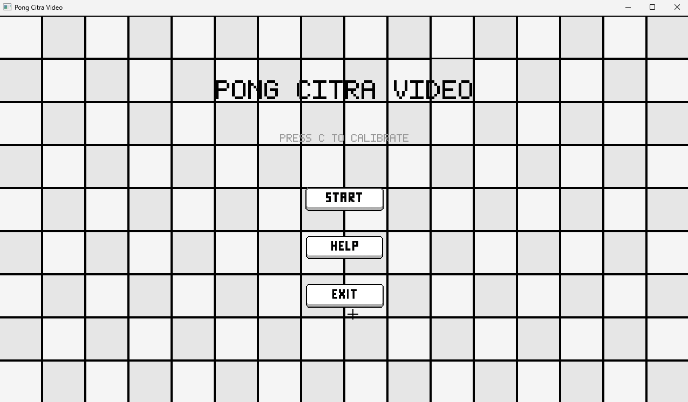
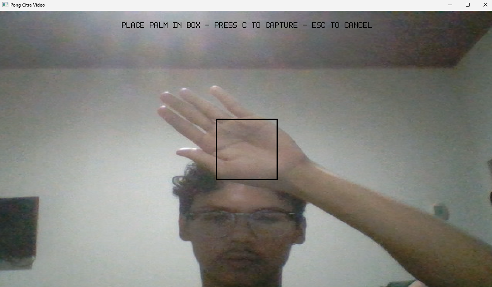
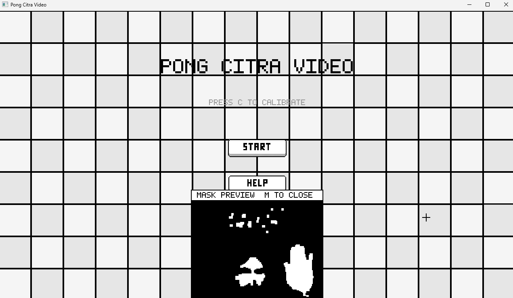
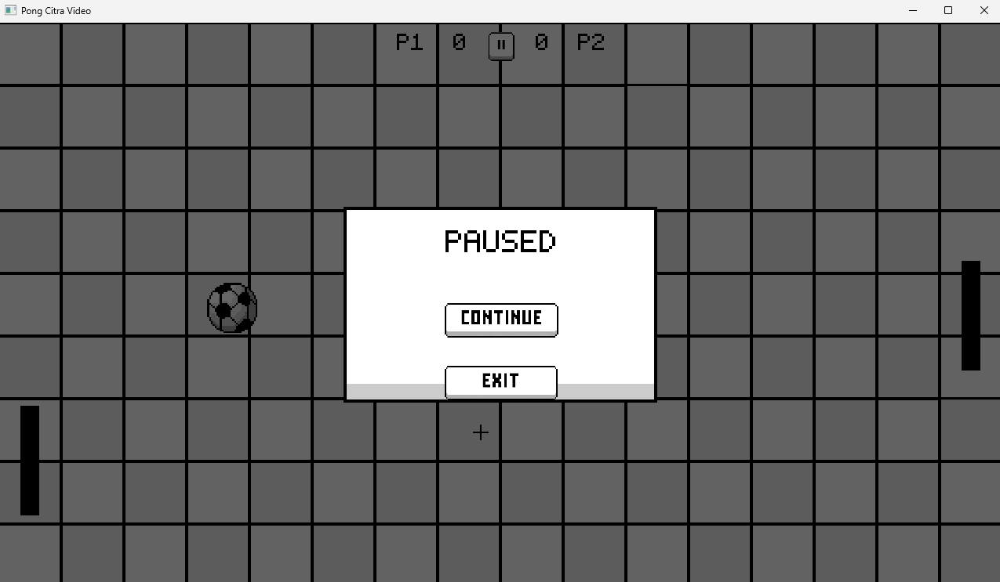
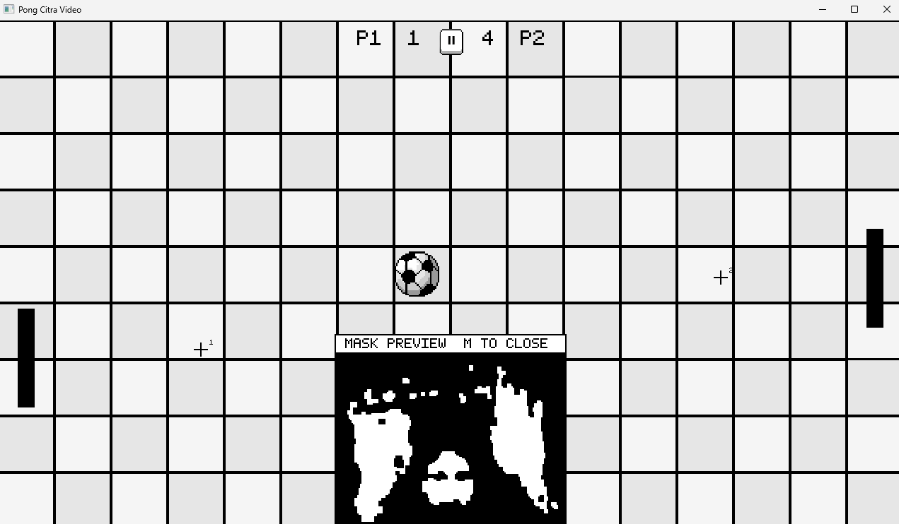
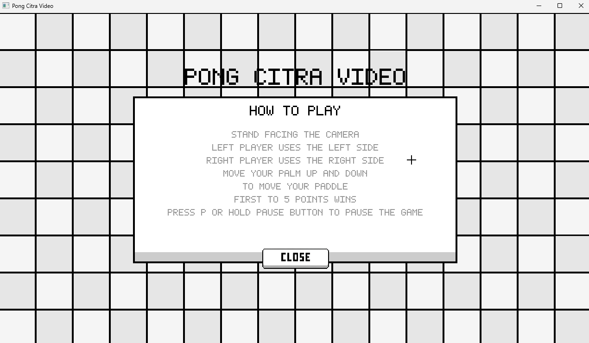

# Pong Citra Video – README

## Overview
Game Pong untuk 2-Player menggunakan deteksi warna telapak tangan menggunakan **OpenCV** melalui kamera web sebagai input penggerak paddle.
Dibuat dengan menggunakan **NumPy** untuk operasi piksel manual dan **OpenCV** hanya untuk imread, imshow, VideoCapture.



## Project Structure

| File | Purpose |
|------|---------|
| `main.py` | Entry point, state machine, game loop |
| `config.py` | All tunable constants |
| `assets.py` | Asset loading, alpha extraction, sprite scaling |
| `render.py` | Drawing primitives: font, blitting, rectangles |
| `vision.py` | BGR→HSV, skin mask, morphology, blob detection |
| `game.py` | Ball physics, paddle state, swept collision |
| `ui.py` | Button dwell logic, screen layouts |
| `asset/` | Image assets (ball, paddle, buttons, background) |

## Requirements
- Python 3.8+
- numpy
- opencv-python

```
pip install numpy opencv-python
```

## Running
```
python main.py
```

## Controls

| Key | Action | Examples |
|-----|--------|---------|
| **C** | Kalibrasi warna kulit untuk tracking |  |
| **M** | Toggle picture-in-picture untuk preview masking |  |
| **ESC** | Exit dari menu |  |


### Gameplay
- Kedua pemain mengendalikan paddles dengan menggerakan tangan, tidak menggunakan mouse atau keyboard untuk gameplay.

- Pemain di sebelah kiri mengendalikan paddle kiri, pemain di sebelah kanan mengendalikan paddle kanan.
- Gerakkan telapak tangan ke atas dan ke bawah untuk mengendalikan paddle.
- Posisikan tangan di atas tombol selama 1 detik untuk menekannya.
- Pemain pertama yang mencetak 5 poin menang



## Calibration (untuk tracking yang lebih mulus)
1. Dari menu, tekan **C** untuk masuk mode kalibrasi.
2. Letakkan telapak tangan di kotak tengah pada layar.

3. Pastikan telapak tangan memenuhi sebagian besar kotak.
4. Tekan **C** lagi untuk menyimpan warna.
5. Gunakan pencahayaan yang konsisten dan ideal.
6. Jika hasil deteksi buruk, ulangi kalibrasi atau sesuaikan pencahayaan.
7. Jauhkan wajah dari area deteksi.

## Constraints
- Only `cv2.imread`, `cv2.imshow`, `cv2.VideoCapture`, `cv2.waitKey`, `cv2.namedWindow`, `cv2.destroyAllWindows` are used from OpenCV.
- All pixel operations are manual NumPy: colour conversion, thresholding, morphology, blob detection, sprite blitting, text rendering.

## Timeline Progress
- Selasa, 13 Oktober 2026: Tugas 5 (Morphology)
- Kamis, 15 Oktober 2026: Test Morphology + Filter + Konversi Warna
- Sabtu, 17 Oktober 2026 - Kamis, 22 Oktober 2026: ETS
- Jumat, 23 Oktober 2026: Brainstorm Ide, Game Design & Assets
- Sabtu, 24 Oktober 2026 -  Minggu, 25 Oktober 2026: Pong Full Game
- Senin, 26 Oktober 2026: Final Clean-up, Readme
  
## Konsep Pengolahan Citra dan Video yang Diaplikasikan

Seluruh operasi piksel dan visi komputer pada game ini diimplementasikan secara mandiri menggunakan **NumPy** tanpa fungsi otomatis/tingkat tinggi OpenCV (OpenCV hanya digunakan untuk I/O kamera dan GUI window).

| No | Konsep PCV & Teori | Implementasi & Kegunaan | Lokasi Kode |
|---|---|---|---|
| **1** | **Representasi Matriks & Spatial Subsampling (P1)** | Mengakses citra sebagai matriks 3D `(H, W, C)` berbasis NumPy. Slicing horizontal `frame[:, ::-1, :]` untuk mirroring kamera, dan subsampling `[::4, ::4]` untuk downsampling resolusi dari 640×480 ke 160×120 secara cepat agar pipeline real-time. | [`vision.py`](vision.py#L226-L229) (`process_frame`) |
| **2** | **Resampling Spasial Nearest-Neighbor (P1 & P3)** | Pembesaran dan pengecilan aset sprite pixel art (*ball*, *paddle*, *font*, *mask PIP*) menggunakan interpolasi tetangga terdekat (*Nearest-Neighbor*) berbasis `np.repeat` dan pemetaan indeks bulat tanpa interpolasi bilinear agar visual retro tetap tajam. | [`render.py`](render.py#L7-L23) (`nn_scale`, `nn_resize`) |
| **3** | **Operasi Aritmatika Piksel & Alpha Blending (P2)** | Penggabungan sprite transparan ke atas kanvas background menggunakan rumus blending: $I_{\text{out}} = \alpha \cdot I_{\text{src}} + (1 - \alpha) \cdot I_{\text{dst}}$ yang dihitung secara *vectorized* dalam float32 sebelum dikembalikan ke uint8. | [`render.py`](render.py#L26-L47) (`blit_alpha`) |
| **4** | **Konversi Ruang Warna Manual BGR ke HSV (P4)** | Mengonversi warna kamera dari model aditif RGB/BGR ke silinder HSV secara manual tanpa `cv2.cvtColor`. Menghitung Value ($V = \max$), Saturation ($S = \frac{\Delta}{V}$), dan Hue ($H$) menggunakan pergeseran sektor $60^\circ$ berbasis modular arithmetic ke skala OpenCV ($H \in [0, 179]$). | [`vision.py`](vision.py#L6-L42) (`bgr_to_hsv`) |
| **5** | **Segmentasi Warna & Thresholding Ganda (P4)** | Segmentasi piksel kulit (*skin masking*) menggunakan batasan ambang batas (*range thresholding*). Menerapkan dua rentang Hue sekaligus yang di-OR-kan untuk menangani sifat *red wrap-around* pada koordinat silinder Hue ($0^\circ/360^\circ$). | [`vision.py`](vision.py#L45-L58) (`skin_mask`) |
| **6** | **Kalibrasi Adaptif Berbasis ROI & Statistik Median (P2 & P4)** | Menentukan ambang batas warna secara adaptif saat runtime dengan mengambil sampel Region of Interest (ROI) pada telapak tangan pemain, kemudian menghitung nilai median $H, S, V$ untuk membentuk *bounding box* toleransi dinamis. | [`vision.py`](vision.py#L267-L313) (`calibrate_from_roi`) |
| **7** | **Operasi Morfologi Citra 3×3 (P5)** | Implementasi manual operasi dasar morfologi matematika: **Erosi** (minimum ketetanggaan / AND logika) dan **Dilasi** (maksimum ketetanggaan / OR logika) menggunakan Structuring Element (SE) kotak $3 \times 3$ dengan padding tepi citra. | [`vision.py`](vision.py#L61-L83) (`erode_3x3`, `dilate_3x3`) |
| **8** | **Pembersihan Derau dengan Opening & Closing (P5)** | **Opening** (Erosi $\rightarrow$ Dilasi) untuk membuang bintik derau latar (*salt noise*), dilanjutkan dengan **Closing** (Dilasi $\rightarrow$ Erosi) untuk menutup lubang kecil pada telapak tangan (*pepper noise*) agar mask biner menjadi solid dan utuh. | [`vision.py`](vision.py#L85-L99) (`morph_open`, `morph_close`) |
| **9** | **Citra Integral / Summed-Area Table (P3)** | Menggunakan citra integral 2D (`np.cumsum` ganda) untuk menghitung jumlah piksel dalam jendela kotak (*box sum*) secara konstan $O(1)$, digunakan untuk mencari titik terpadat (*densest seed point*) pada area tangan secara instan. | [`vision.py`](vision.py#L102-L119) (`_integral_image`, `_box_sum`) |
| **10** | **Ekstraksi Komponen Terhubung / Region Growing (P5)** | Algoritma *Connected Components* manual berbasis *seeded region growing*: menanam benih (*seed*) pada titik densitas tertinggi, lalu menumbuhkannya secara berulang menggunakan dilasi bersyarat $(A \oplus B) \cap \text{Mask}$ hingga konvergen untuk mengisolasi tangan dari noise sekitar. | [`vision.py`](vision.py#L122-L160) (`largest_blob`) |
| **11** | **Ekstraksi Fitur Spasial: Momen & Centroid (P1 & P5)** | Menghitung momen spasial orde pertama untuk mendapatkan koordinat pusat massa (*Centroid*) $\bar{y} = \frac{1}{N} \sum y_i$ dan $\bar{x} = \frac{1}{N} \sum x_i$ dari mask tangan sebagai representasi posisi paddle dan kursor UI. | [`vision.py`](vision.py#L179-L182) (`HandTracker.update`) & [`L208-L211`](vision.py#L208-L211) (`CursorTracker.update`) |
| **12** | **Flood-Fill Alpha Extraction (P5)** | Pembuatan transparansi mask otomatis dari sudut citra tombol/bola menggunakan ekspansi tetangga (*flood-fill 4-connectivity*) pada piksel latar belakang putih. | [`assets.py`](assets.py#L10-L38) (`_flood_fill_alpha`) |a716
